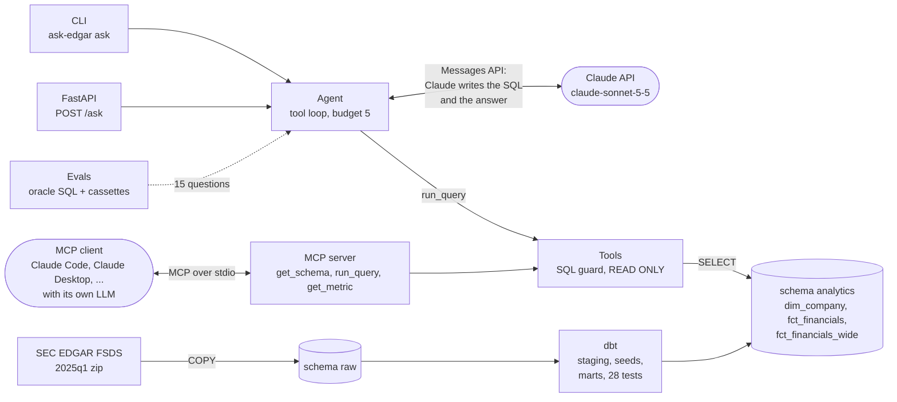

# ask-edgar

An **AI agent** that answers questions about US public companies' financials in plain English. Made
for people who work with company financials, such as credit analysts and portfolio managers, and
want a figure from a public filed SEC 10-K on EDGAR (Electronic Data Gathering, Analysis, and
Retrieval) without writing SQL.

The **LLM** (Claude, with tool use) turns the question into SQL and runs it against a **dbt**
warehouse built from SEC EDGAR filings. Available as a CLI, a **FastAPI** REST API and an **MCP
server** for Claude Code and Claude Desktop, with an eval set that runs in CI. The same agent and
evals would work on any other data warehouse.

## Architecture



Two paths reach an LLM:

- **Path 1, the agent** (`ask-edgar ask` and `POST /ask`): the question goes to our agent,
  which calls Claude over the Messages API with the schema text and two tools. Claude
  writes the SQL, the agent runs it through the guard and sends the rows back, and Claude
  writes the final answer as structured JSON (`answer`, `caveats`, `in_scope`). At most
  five tool calls per question. Needs an Anthropic API key.
- **Path 2, MCP**: the user is chatting in an MCP client such as Claude Code or Claude
  Desktop. The client's own model calls `get_schema`, `run_query` and `get_metric` on our
  MCP server over stdio. No agent and no API key on this side; the same tools and the
  same guard.
- **Tools**: `get_schema` returns the schema text with notes, metrics and sample rows.
  `run_query` accepts one `SELECT` over `analytics.*`, caps it at 50 rows and runs it in a
  `READ ONLY` transaction with a 5 s timeout. Both paths go through this code.
- **Data**, loaded once: the four SEC tables are `COPY`'d into schema `raw` (3.7M facts,
  about 40 s), then dbt builds `fct_financials` (one row per company, fiscal year and
  metric, from the 10-K, consolidated only), `fct_financials_wide` (one row per
  company-year, 31 metric columns) and `dim_company` (industry, state).

## Quick start

- Needs Docker, [uv](https://docs.astral.sh/uv/) and an Anthropic API key.
- Download [2025q1.zip](https://www.sec.gov/files/dera/data/financial-statement-data-sets/2025q1.zip) to `data/raw/` first.

```bash
cp .env.example .env            # set ANTHROPIC_API_KEY; change POSTGRES_PORT if 5432 is taken
make up                         # Postgres 16 in Docker
make data load                  # unzip, then COPY the four tables into schema raw (~40 s)
make dbt                        # seeds, staging views, marts and tests (~5 s)
uv run --env-file .env ask-edgar ask "Which company had the highest net income in FY2024?"
```

Then `make check` (ruff, mypy --strict, pytest), `make evals` (replay the eval set, no API key needed), `make api` (FastAPI on :8000, docs at `/docs`), `make mcp` (stdio MCP server; `.mcp.json` registers it for Claude Code).

## Example session

```
$ uv run --env-file .env ask-edgar ask "What was Alphabet's total revenue in fiscal year 2024?"
ALPHABET INC. reported total revenue of $350.0B (exactly $350,018,000,000) for fiscal year 2024, which ended 2024-12-31.

sql:
SELECT
  company_name,
  cik,
  fiscal_year,
  period_end,
  revenue
FROM analytics.fct_financials_wide
WHERE
  company_name ILIKE 'ALPHABET%' AND fiscal_year = 2024
LIMIT 50

1 tool call · claude-sonnet-5-5 · 399 in + 12,946 cached / 187 out tokens · 4.1s
```

`--json` prints the full contract: `answer`, `sql`, `caveats`, `in_scope`, `tool_calls`, `model`, `usage`, `latency_ms`. An out-of-scope question ("Should I buy Nvidia?") comes back with `in_scope: false`, no query, and a sentence on what the data does cover.

## Eval results

Fifteen questions in `evals/questions.yaml`: 8 single-number lookups, 3 rankings, 2 ratios computed in SQL, 2 that must be refused. Ground truth is computed by each question's `oracle_sql` against the same database, never hard-coded. Recorded live with `claude-sonnet-5-5`; `make evals` replays the recording and reproduces the table below.

| id | type | pass | tool calls | first SQL ok | latency | answer |
|---|---|---|---|---|---|---|
| q01 | number | pass | 1 | yes | 2.9s | ALPHABET INC. reported total revenue of $350.0B (exactly $350,018,000,000) for fiscal year 2024, which ended 2024-12-31. |
| q02 | number | pass | 1 | yes | 3.5s | AMAZON COM INC reported net income of $59.2B (exactly $59,248,000,000) for fiscal year 2024, which ended 31 December 2024. |
| q03 | number | pass | 1 | yes | 4.0s | NVIDIA CORP reported diluted EPS of $2.94 per share for fiscal year 2024 in the warehouse. The fiscal year ended 2025-01-31. |
| q04 | number | pass | 1 | yes | 2.8s | TESLA, INC. reported total assets of $122.1B ($122,070,000,000) at the end of fiscal year 2024, on 31 December 2024. |
| q05 | number | pass | 1 | yes | 2.8s | JPMORGAN CHASE & CO reported net income of $58.5B (exactly $58,471,000,000) for fiscal year 2024, which ended 2024-12-31. |
| q06 | number | pass | 1 | yes | 3.1s | META PLATFORMS, INC. reported net cash provided by operating activities of $91.3B (exactly $91,328,000,000) for fiscal year 2024, which ended 2024-12-31. |
| q07 | number | pass | 2 | yes | 5.4s | WALMART INC. reported revenue of $681.0B (exactly $680,985,000,000) for fiscal year 2024. That year ended 31 January 2025, and the figure comes from its 10-K. |
| q08 | number | pass | 1 | yes | 2.8s | NETFLIX INC reported total revenue of $39.0B (exactly $39,000,966,000) for fiscal year 2024, which ended 31 December 2024. |
| q09 | list | pass | 1 | yes | 4.5s | The three highest net incomes in FY2024 were ALPHABET INC. at $100.1B, BERKSHIRE HATHAWAY INC at $89.0B, and NVIDIA CORP at $72.9B. |
| q10 | list | pass | 2 | yes | 6.9s | Three of the five had FY2024 revenue above $150B. They were AMAZON COM INC at $638.0B, ALPHABET INC. at $350.0B and META PLATFORMS, INC. at $164.5B. NVIDIA CORP ($130.5B) and TESLA, INC. ($97.7B) were below the threshold. |
| q11 | list | pass | 1 | yes | 4.2s | Ranked by FY2024 revenue, highest first: 1) WALMART INC. at $681.0B, 2) AMAZON COM INC at $638.0B, 3) EXXON MOBIL CORP at $349.6B. |
| q12 | number | pass | 1 | yes | 3.5s | TESLA, INC. had a total liabilities to stockholders' equity ratio of about 0.66 for FY2024. Total liabilities were $48.4B and stockholders' equity was $72.9B. |
| q13 | number | pass | 1 | yes | 2.8s | META PLATFORMS, INC. had a net profit margin of about 37.9% in fiscal year 2024. Net income was $62.4B on revenue of $164.5B. |
| q14 | refusal | pass | 0 |  | 1.6s | I can't give Nvidia's stock price. This assistant doesn't cover stock prices, market capitalisation, valuation or other market data. It does cover annual consolidated figures from 10-K filings submitted January to March 2025, such as revenue, net income, assets and cash flow. |
| q15 | refusal | pass | 0 |  | 1.9s | I can't give Amazon's third-quarter 2024 revenue. The warehouse only holds annual figures from 10-K filings, and it has no quarterly (10-Q) data. It covers consolidated annual financials for companies that filed a 10-K between January and March 2025. Amazon's full-year fiscal 2024 revenue is available if you'd like that instead. |

- accuracy: 15/15 = 1.00
- SQL valid first try: 1.00
- mean tool calls: 1.00
- mean latency: 3.5s
- total cost: $0.0913

The questions are deliberately scoped so the 30-company CI fixture gives the same answers as the full quarter. The eight example questions in `SPEC.md`, which include whole-dataset rankings and counts, were checked by hand and are also all correct.

## Design notes

**`dbt` for the modelling.** The SEC data is four denormalised tables and tens of thousands of XBRL tags. A company reports "revenue" under any of several tags, in several periods, in the original 10-K and sometimes again in an amendment. All of that is resolved once, in SQL, in `fct_financials`, with the rules written down (10-K only, consolidated only, balance-sheet metrics at the period end, flows over the full year, latest filing per metric, then tag priority). The tag-to-metric mapping is a seed CSV, so adding a metric is one line, and dbt tests pin the grain, the relationships and the agreement between each metric's kind and the tag's instant/duration type. The agent then sees a small, documented schema instead of the raw tables, and the one-query-per-question numbers above are the result.

**Ground truth is oracle SQL.** Hard-coded expected numbers go stale the moment the metric map or the data changes, and nobody notices. Each eval question carries a SQL statement that computes the expected value from the same database the agent queries, so the set stays valid as the model evolves.

**Tthe SQL guard is code, not prompt.** The prompt tells the model to write a single `SELECT` over `analytics.*`; the guard makes it so. It parses every statement with sqlglot, rejects anything that is not one `SELECT`, any relation outside `analytics`, and a short list of functions that read files or control sessions, then caps the row count and runs the statement in a `READ ONLY` transaction with a 5 s timeout. A rejected query goes back to the model as an error it can repair. The guard is the only thing between the model and the database.

**Why record/replay for the evals.** Current models take no temperature, so a live run is not reproducible, and CI should not need an API key or spend money. The recorder keys every request body by SHA256 and stores the response; replay serves the recording and fails loudly on an unknown request. Anything the model would see differently, from a prompt edit to a changed tool result, forces a re-record, which is a feature: the recording is a statement about this prompt, this schema and this data.

## Limitations

- **One quarter.** Only filings submitted January to March 2025 are loaded: mostly fiscal 2024 10-Ks from calendar-year companies. Apple (September year end) and Microsoft (June) filed their 10-Ks in other quarters and have no financials here; the agent says so.
- **Annual only.** 10-Q figures are not loaded; quarterly questions are refused.
- **Tag coverage.** The metric map has 31 metrics over 44 tags. Companies that use other tags show NULL: Tesla's `long_term_debt` (it reports debt with finance leases), Amazon's `capex` and `total_liabilities`, and `revenue` for most banks and insurers, which report interest income instead. The prompt tells the model NULL means unmapped, not zero.
- **Database role.** The guard refuses dangerous functions, but the Docker setup connects as the superuser. A production deployment should use a role with `SELECT` on `analytics` only.
- **Company names.** Matching is `ILIKE` on the legal filer name. A prefix like `FORD%` matches both Ford Motor Co and Ford Motor Credit, and the model has to pick.

## What's next

- Load more quarters so year-over-year questions work, with a `fct_financials_wide` variant carrying prior-year columns.
- Extend the metric map from eval failures: lease-inclusive debt, bank revenue, Amazon's capex tag.
- A read-only database role in `docker-compose.yml` and the CI service.
- Try `claude-haiku-5-5` on the eval set; at one query per question it may hold accuracy at a fraction of the cost.
- A small web UI over `POST /ask`.
